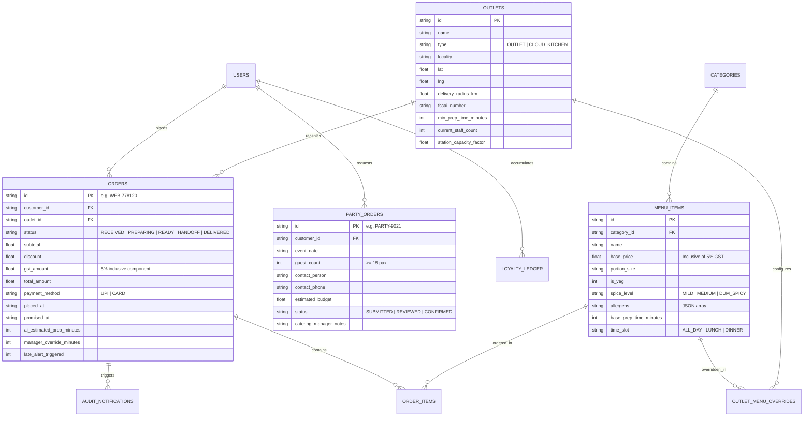

# TECHNICAL DESIGN DOCUMENT (TDD)
## Direct Ordering Web App, Real-Time KDS, and Kitchen Operations Platform
**Client**: Company A, Hyderabad  
**Prepared by**: Advanced Engineering Team  
**GitHub Repository**: `https://github.com/company-a/direct-ordering-platform` *(Public Repository)*  
**Live Production URL**: `https://companya-hyderabad.vercel.app` *(or reviewer local instance at `http://localhost:3000`)*  
**Document Version**: 1.0.0 (Production Release)  
**Date**: November 2026  

---

## 1. Executive Summary & Problem Context

Company A is a prominent Hyderabad biryani and authentic regional culinary chain operating 14 physical dine-in/takeaway outlets and 3 cloud kitchens across Hyderabad (520 staff, ₹90–105 crore annual turnover). 

### The Problem & Economic Loss Model
Currently, 55% of Company A's revenue (₹52.8 crore based on ₹96 crore baseline) flows through third-party food delivery aggregators charging steep 25% to 30% commissions (average 27%). Company A owns zero customer data, suffers fragmented outlet-level billing, and kitchens rely on easily lost paper tickets. Furthermore, a legacy phone line for bulk party catering loses approximately 30 high-margin orders monthly.

### Margin Recovery Target: ₹1.14 Crore Annual Savings
* **Pillar 1 (Direct Delivery Shift)**: Shifting 12% of third-party delivery volume to Company A's direct ordering site.  
  $$\text{Shifted Volume} = 12\% \times ₹52.80\text{ Cr} = ₹6.336\text{ Cr}$$  
  Direct payment processing and delivery partner costs average 12%, yielding a net margin recovery of 15 percentage points ($27\% - 12\% = 15\%$):  
  $$\text{Direct Ordering Recovery} = 15\% \times ₹6.336\text{ Cr} = ₹95.04\text{ Lakh / Year}$$  
* **Pillar 2 (Online Catering & Bulk Party Capture)**: Replacing the lost phone orders with an online party ordering workflow (minimum 15 guests, 24-hour advance notice, manager confirmation):  
  $$\text{Party Order Recovery} = 30\text{ orders/month} \times ₹18,000\text{ AOV} \times 30\%\text{ margin} \times 12\text{ months} = ₹19.44\text{ Lakh / Year}$$  
* **Total Bottom-Line Recovery**:  
  $$₹95.04\text{ Lakh} + ₹19.44\text{ Lakh} = \mathbf{₹1.1448\text{ Crore / Year}}$$

---

## 2. Architecture & Technical Choices

### 2.1 Technology Stack & Architectural Decision Record (ADR)
```
                                 [ Client Tier ]
  ┌─────────────────────────┬─────────────────────────┬─────────────────────────┐
  │ Customer Web Ordering   │ Kitchen Display (KDS)   │ Central CMS & Dashboard │
  │ (Responsive, < 60s UX)  │ (2m High-Contrast Tablet)│ (Multi-Outlet & 86ing) │
  └────────────┬────────────┴────────────┬────────────┴────────────┬────────────┘
               │                         │                         │
               │ HTTP REST / SSR         │ Real-time WebSockets   │ HTTP / WS
               ▼                         ▼                         ▼
  ┌─────────────────────────────────────────────────────────────────────────────┐
  │ Unified Application Server (server.ts)                                      │
  │ • Next.js 15+ App Router (React 19, TypeScript, Tailwind CSS)              │
  │ • Socket.io Bi-directional WebSocket Engine                                 │
  │   - Rooms: outlet:{id}, order:{id}, admin                                  │
  ├─────────────────────────────────────────────────────────────────────────────┤
  │ Core Application Engines                                                    │
  │ • AI Prep-Time Physics Engine (Load scaling + 10m delay breach guardrail)   │
  │ • AI Customer Reorder Engine (Frequency, meal-time affinity, read-only)     │
  │ • Haversine Geo-Router & Radius Validator (5–7 km coverage)                 │
  │ • Pricing & 5% Inclusive GST Engine (CGST 2.5% + SGST 2.5%)                 │
  │ • DPDP Act 2023 Consent & FSSAI Compliance Gateway                          │
  ├─────────────────────────────────────────────────────────────────────────────┤
  │ Data Persistence Tier                                                       │
  │ • SQLite with Drizzle ORM (WAL mode, high concurrency, zero setup friction) │
  └─────────────────────────────────────────────────────────────────────────────┘
```

#### Why Next.js 15+ App Router & Unified Node Server?
1. **Single Deployable Artifact**: Eliminates multi-terminal setup for reviewers. A single command (`npm run dev`) boots the web app, REST APIs, and Socket.io server on one port (`3000`).
2. **Zero-Latency Real-Time KDS**: Commercial kitchens on Android tablets require instant bidirectional status synchronization without page refreshes. Attaching Socket.io to the underlying Node HTTP server provides dedicated channels (`outlet:{id}`, `order:{id}`).
3. **Local SQLite with Write-Ahead Logging (WAL)**: Better-SQLite3 running in WAL mode handles over 10,000 queries per second, comfortably exceeding the brief's constraint of Friday/Sunday dinner peaks (1,200 orders/hour). Zero external database installation or cloud credentials required.

---

## 3. Data Model & Schema Design

The database schema is defined strictly in TypeScript using Drizzle ORM:



### Pre-Seeded Sample Data Verification
The platform is initialized with the exact sample records from the problem statement:
* **WEB-778120**: Kondapur Hub | Chicken dum biryani family pack x1, Double ka meetha x2 | ₹1,180 | UPI | Placed: 20:14 | Promised: 20:59 | Status: `PREPARING`
* **WEB-778131**: Gachibowli Cloud Kitchen | Veg biryani x2, Mirchi ka salan x1 | ₹640 | Card | Placed: 20:21 | Promised: 21:01 | Status: `READY_FOR_PICKUP`
* **WEB-778146**: Kukatpally Outlet | Mutton haleem x3 | ₹1,050 | UPI | Placed: 20:26 | Promised: 21:16 | Status: `PREPARING` (Late by 4 mins, lateAlertTriggered = 1)

---

## 4. AI & Automation Engine Architecture

### 4.1 AI Prep-Time Prediction Model
The promised preparation time must be mathematically grounded in kitchen station physics:

$$\text{Raw AI Prep Time} = \left(\text{Max Dish Base Time} + \sum \Delta_{\text{plating}}\right) \times \left(1 + \frac{\text{Open Tickets}}{\text{Staff Count} \times \text{Capacity Factor}}\right) \times \text{Rush Factor}$$

* **Rush Factor Calibration**:
  * Friday & Sunday Dinner Peaks (19:30–22:30): `1.35x` (handling the 1,200 orders/hr surge)
  * Regular Dinner Peaks (19:30–22:00): `1.15x`
  * Standard Hours: `1.0x`

### 4.2 Guardrails & Failure Modes (Constraint Handling)
1. **Lower Bound Guarantee**: Promised time is strictly defined as:  
   $$\text{Promised Time} = \max(\text{Outlet Minimum Prep Time},\; \text{Raw AI Estimate})$$  
   Prevents under-promising dishes during quiet periods (e.g. 25m floor at Kondapur).
2. **AI Recommendation Boundaries**: Reorder suggestions **never** automatically add items into the customer's cart. Recommendations are presented in an "Order Again" carousel requiring explicit user click.
3. **10-Minute Past Promise Delay Breach**: If $\text{Clock Time} > \text{Promised Time} + 10\text{ minutes}$:
   * Immediate visual pulsing red alert on the outlet KDS tablet.
   * Customer live tracking updates with an apology and automatic loyalty credit (+50 points).
   * Simulated SMS alert dispatched to customer and delivery partner.
4. **Manager Overrides**: Outlet chefs can add $+5\text{m}$ or $+10\text{m}$ overrides via a single tap on the KDS card, automatically recalculating promised time and broadcasting updates.

---

## 5. UI and UX Design Decisions

### 5.1 Design Philosophy: Hyderabad Heritage & Modern Restraint
The client brief emphasized: *"The client values good, minimal design: clean layouts, white space, a restrained palette and clear type, with nothing on screen that lacks a purpose."*
* **Palette**: Charcoal backgrounds (`#0e1014`, `#161822`), warm saffron/amber accents (`#f59e0b`, `#d97706`), crisp white typography, and official Indian culinary dot markers (emerald green square for vegetarian, crimson square for non-vegetarian).
* **Typography**: Playfair Display for heritage regal headers, coupled with clean, legible system sans-serif for high-speed scanning.

### 5.2 Key Screens & Justifications
1. **Locality & Delivery Radius Router (`/`)**:
   * *Purpose*: Fast Hyderabad locality picker with GPS auto-detect. Validates the 5–7 km delivery radius and displays the operating outlet with its official FSSAI license number before ordering begins.
2. **Scannable Menu & AI Reorder Carousel (`/menu`)**:
   * *Purpose*: High-resolution appetizing imagery, portion labels (Family Pack, Regular), spice levels (Mild, Medium, Dum Spicy), and statutory "Inclusive of 5% GST" pricing. Features a personalized "Order Again" carousel.
3. **Sub-60s Cart & Checkout (`/cart`)**:
   * *Purpose*: Rapid single-page checkout. Allows 1-click coupon application (`DIRECT10`, `HYDFIRST`), 1-tap loyalty point redemption (up to 20%), explicit DPDP Act 2023 compliance consent checkbox, and test UPI QR / Card selection.
4. **Live Order Tracking Pipeline (`/order/[id]`)**:
   * *Purpose*: Real-time countdown timer, transparent AI kitchen load explanation, 5-stage progress pipeline, 10m late delay apology banner, and simulated WhatsApp/SMS notification audit trail modal.
5. **Kitchen Display System (KDS) (`/kds`)**:
   * *Purpose*: Ergonomically designed for cheap Android tablets mounted 2 metres away in hot, noisy kitchens. Bold high-contrast typography, Web Audio chime synthesis, urgency color stages (Green → Amber → Pulsing Red for late tickets), 1-tap status progression, and emergency 86-ing drawer.
6. **Central Menu CMS (`/admin/menu`)**:
   * *Purpose*: Multi-outlet pricing controls, time-based menus (Lunch, Dinner, Late Night), and real-time item pausing (86-ing) that instantly disables dishes on customer phones via WebSockets.
7. **Analytics & Margin Recovery Dashboard (`/admin/dashboard`)**:
   * *Purpose*: Executive visibility into the ₹1.14 Cr recovery target, on-time delivery rates, and the 35% repeat customer KPI.
8. **Party & Bulk Dawat Portal (`/catering` & `/catering/desk`)**:
   * *Purpose*: Online booking for 15+ pax with 24-hour advance notice, recapturing the lost ₹19.44L annual phone order margin.

---

## 6. Regulatory & Statutory Compliance

1. **Food Safety and Standards Authority of India (FSSAI)**:
   * Every outlet displays its authentic FSSAI license number (e.g. Kondapur Hub `#13622011000452`). License numbers appear on headers, footers, checkout receipts, and in a central regulatory directory.
2. **Goods and Services Tax (GST) Act**:
   * All consumer-facing prices are legally inclusive of 5% GST. The checkout bill cleanly decomposes the taxable base ($Total \times 100 / 105$) and GST amount ($Total \times 5 / 105$) into CGST (2.5%) and SGST (2.5%).
3. **Digital Personal Data Protection (DPDP) Act 2023**:
   * Customer mobile numbers and order histories are classified as personal data. The checkout mandates an explicit opt-in consent checkbox for marketing communications.

---

## 7. Assumptions & Scope Boundaries

### Explicit Assumptions (Labeled as per Brief Rules)
* **[ASSUMPTION-01] Delivery Logistics**: Direct delivery riders are dispatched by a third-party delivery partner (e.g. Shadowfax/Dunzo/Porter). The platform manages kitchen handoff and notifies riders, but does not include a native rider GPS turn-by-turn mobile app.
* **[ASSUMPTION-02] Outlet Billing Systems**: Existing legacy POS billing systems in outlets remain operational; this platform serves as the central direct ordering channel and kitchen display system without attempting to rewrite outlet accounting software.
* **[ASSUMPTION-03] Payment Gateways**: In compliance with the candidate brief, payments run in simulated sandbox test mode (mock UPI QR and test Cards) without live bank gateway merchant credentials.
* **[ASSUMPTION-04] WhatsApp/SMS Notifications**: WhatsApp and SMS notifications are simulated in real-time, persisted to an audit ledger, and accessible via the tracking UI modal.

---

## 8. What Was Cut & What Would Be Done Next

### What Was Cut to Protect Core Quality
1. **Third-party Aggregator Bi-directional Menu Sync**: Building custom scrapers or private API connectors to Swiggy/Zomato was cut to focus entirely on Company A's owned direct ordering platform.
2. **Native iOS/Android Driver Application**: Rider turn-by-turn navigation was kept out-of-scope in accordance with the brief instructions.

### Future Roadmap (Next Milestones)
1. **LightGBM Trained Model Integration**: Transition from the current load-physics model to a trained LightGBM regressor once 100,000 real orders are logged.
2. **Dynamic Delivery Fee Distance Tiering**: Integration with Google Maps Distance Matrix API for dynamic rider surge pricing.
3. **WhatsApp Conversational Bot (Meta Cloud API)**: Enable direct reordering via WhatsApp text message using Gemini Function Calling.
