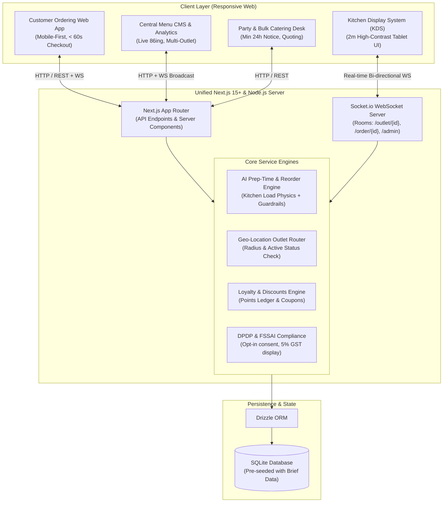

# Implementation Plan: Company A Direct Ordering & Kitchen Operations Platform

Company A is a prominent Hyderabad-based biryani and Hyderabadi culinary chain operating 14 physical outlets and 3 cloud kitchens across Hyderabad (520 staff, ₹90–105 Cr annual revenue, 55% delivery app dependency). This project builds a direct ordering web application, central menu CMS, real-time Kitchen Display System (KDS), AI-driven prep-time prediction & reorder engine, and catering/party order management system to recoup ₹1.14 Cr annually in commission losses and phone line leakages.

---

## User Review Required

> [!IMPORTANT]
> **Key Decisions Agreed Upon**:
> 1. **Technology Stack**: Next.js (App Router, React 19, TypeScript, Tailwind CSS), SQLite with Drizzle ORM for local resilience and zero-friction reviewer execution.
> 2. **Real-Time Engine**: Full bi-directional WebSockets via Socket.io mounted on a unified Next.js HTTP server (`server.ts`).
> 3. **AI Prep-Time & Reorder Engine**: Statistical load-based physics model (item base time × active burner tickets × rush/staff factor) with ML gradient-boosted architecture specification, transparent explainability, and strict guardrails.
> 4. **Authentication & Reviewer Persona**: Dual Mode—One-click Demo Persona Switcher (Customer Amina, Kondapur Kitchen Staff, Central Admin, Catering Manager) plus standard Phone OTP/Email sign-in.
> 5. **Deliverables**: In addition to the working application and test suite, both a styled PDF and Word (`.docx`) Technical Design Document (TDD) along with `deployment.md` will be generated and packaged into `submission.zip`.

---

## Architecture & System Overview



---

## Core Flows & Feature Scope

### 1. Customer Ordering Web App (< 60s Checkout)
- **Outlet Selection & Geo-Routing**: Customer selects their Hyderabad locality (Kondapur, Gachibowli, Kukatpally, Banjara Hills, Charminar, etc.) or uses GPS. System validates 5–7 km delivery radius and auto-assigns the nearest active outlet.
- **Scannable Hyderabad Menu**: High-resolution imagery, portions (Single, Family Pack, Jumbo Handi), official veg/non-veg green/red indicators, spice gauge (Mild, Medium, Dum Spicy), allergen declarations (Dairy, Nuts, Gluten), and statutory "Inclusive of 5% GST" notice.
- **AI Reorder Recommendations**: Personalized "Order Again" carousel highlighting customer's frequent dishes based on past tickets and meal-time affinity. *Guardrail*: Never automatically added to cart; user must click "Add".
- **Cart & Fast Checkout**:
  - Add-ons selector (Mirchi Ka Salan, Burani Raita, Double Ka Meetha).
  - Loyalty Points Redemption (1 point = ₹1, redeem up to 20% of order).
  - Coupon application (`DIRECT10` 10% off, `HYDFIRST` ₹100 off).
  - **DPDP Act 2023 Compliance**: Explicit checkbox for marketing consent ("I agree to receive order notifications and marketing updates under DPDP Act 2023").
  - Test Payment Gateways: Simulated UPI (QR scan / VPA) & Card payment with instantaneous transition.
- **Live Order Tracking**:
  - Real-time order progress timeline (Received → Preparing → Ready for Pickup → Rider Handoff → Delivered).
  - Countdown timer showing promised time vs AI dynamic estimate.
  - 10-minute late alert with automatic notification and delay apology banner.
  - Simulated WhatsApp & SMS message stream with modal audit log.

### 2. Kitchen Display System (KDS)
- **Ergonomics for Cheap Android Tablets**:
  - 2-metre readable high-contrast layout, large touch targets, glare-resistant dark mode.
  - Audio chimes (toggleable) for new orders and late order alerts.
- **Color-Coded Urgency Matrix**:
  - Green / Normal: On schedule (> 10 mins remaining).
  - Amber: Approaching threshold (< 5 mins remaining).
  - Red / Pulsing: LATE (e.g. sample `WEB-778146` late by 4 minutes).
- **Prep Stages & State Machine**:
  - One-tap status progression: `New` → `Preparing` → `Ready for Pickup` → `Rider Handoff`.
- **Manager Overrides & Real-time 86ing**:
  - Kitchen manager can override prep time (+5m, +10m, custom).
  - One-click item pausing ("86ing") when biryani pot empties; instantly reflects across customer menus via WebSockets.

### 3. Central Menu CMS & Multi-Outlet Administration
- **Global & Outlet-level Pricing**: Base Hyderabad pricing with outlet-specific overrides.
- **Time-Based Menu Scheduling**: Lunch (11:00–16:00), Dinner (18:00–23:00), Late-Night Dum Biryani (23:00–02:00).
- **FSSAI & Regulatory Control**: Configurable FSSAI license numbers per outlet (e.g., `13622011000452`), allergen flags, and nutritional notices.

### 4. Outlet Manager Analytics Dashboard
- **Real-Time KPIs**: Today's orders, revenue, avg prep time vs promise, cancellation rate, 30-day repeat customer rate.
- **Kitchen Load Meter**: Active tickets vs station capacity factor.
- **Cross-Outlet Performance Benchmarks**: Kondapur vs Gachibowli Cloud Kitchen vs Kukatpally.

### 5. Party & Bulk Order Management (Lost ₹19.44L Recovery)
- Minimum 15-pax guest selector and 24-hour advance notice requirement.
- Nizami feast package builder, custom menu selections, instant price estimation.
- Catering Manager Portal: Review incoming requests, send quotes, approve and route to dedicated cloud kitchens.

---

## Realistic Sample Data Pre-Seeding

The database will be pre-loaded with the exact problem statement records:

| Order ID | Outlet | Items | Total ₹ | Payment | Placed | Promised | Status |
| :--- | :--- | :--- | :--- | :--- | :--- | :--- | :--- |
| **WEB-778120** | Kondapur | Chicken dum biryani family pack x1, Double ka meetha x2 | ₹1,180 | UPI | 20:14 | 20:59 | Preparing |
| **WEB-778131** | Gachibowli cloud kitchen | Veg biryani x2, Mirchi ka salan x1 | ₹640 | Card | 20:21 | 21:01 | Ready for pickup |
| **WEB-778146** | Kukatpally | Mutton haleem x3 | ₹1,050 | UPI | 20:26 | 21:16 | Late by 4 minutes |

Plus 17 pre-configured Hyderabad locations (14 physical outlets + 3 cloud kitchens), 25+ authentic menu items with appetizing imagery, and sample customer profiles.

---

## AI Prep-Time Engine & Guardrails

### 1. Calculation Model
$$\text{Estimated Prep Time} = \max\left(\text{Outlet Min Prep Time},\; \sum (\text{item\_base\_time} \times \text{qty}) \times \left(1 + \frac{\text{Open Active Tickets}}{\text{Staff Count} \times 2.5}\right) \times \text{Rush Factor}\right)$$

- **Rush Factor**:
  - Normal Hours: `1.0`
  - Friday & Sunday Dinner Peak (19:30–22:30): `1.35`
  - Cloud Kitchen Surge: `1.15`

### 2. Guardrails & Failure Modes
1. **Promised Time Lower Bound**: Always $\ge$ outlet minimum prep time (e.g. 25 minutes).
2. **AI Recommendation Boundaries**: Reorder suggestions never auto-populate into cart without explicit customer click.
3. **10-Minute Delay Trigger**: When clock time exceeds `promised_at + 10m`:
   - System triggers red visual alert on KDS.
   - Customer live tracking banner displays delay explanation and voucher credit.
   - Simulated WhatsApp SMS apology sent with delivery partner alert.
4. **Manager Override**: Outlet supervisor can override predicted times with manual input.

---

## Proposed Project Structure

```
submission/
├── server.ts                    # Custom Node.js HTTP server + Socket.io + Next.js handler
├── package.json
├── tsconfig.json
├── tailwind.config.ts
├── drizzle.config.ts
├── src/
│   ├── app/
│   │   ├── layout.tsx           # Global layout with Demo Persona switcher bar
│   │   ├── page.tsx             # Customer landing / outlet selector
│   │   ├── menu/page.tsx        # Menu catalog, AI recommendations, item drawer
│   │   ├── cart/page.tsx        # Cart, loyalty redemption, DPDP opt-in, checkout
│   │   ├── order/[id]/page.tsx  # Customer live order tracker + SMS/WhatsApp log
│   │   ├── kds/page.tsx         # Outlet Kitchen Display System (2m high-contrast)
│   │   ├── admin/menu/page.tsx  # Central Menu CMS & 86 toggle
│   │   ├── admin/dashboard/page.tsx # Outlet performance & analytics
│   │   ├── catering/page.tsx    # Bulk & Party order submission form
│   │   ├── catering/desk/page.tsx # Catering manager confirmation desk
│   │   └── api/                 # REST endpoints for orders, menu, payments, AI
│   ├── components/
│   │   ├── DemoBar.tsx          # 1-click persona switch (Customer, Kitchen, Admin)
│   │   ├── FoodCard.tsx         # Veg/non-veg, spice meter, allergen tag, GST info
│   │   ├── KDSTicket.tsx        # KDS card with timer, color status, sound trigger
│   │   ├── NotificationModal.tsx# Simulated WhatsApp/SMS preview modal
│   │   └── AuthModal.tsx        # Phone OTP / Password login modal
│   ├── lib/
│   │   ├── db/                  # Drizzle ORM schema & SQLite connection
│   │   │   ├── schema.ts
│   │   │   ├── seed.ts
│   │   │   └── index.ts
│   │   ├── ai/                  # AI prep-time & reorder recommendation engines
│   │   │   ├── prepPredictor.ts
│   │   │   └── reorderEngine.ts
│   │   ├── socket/              # WebSocket client & server helpers
│   │   └── constants.ts         # Hyderabad locations, FSSAI numbers, tax rates
│   └── tests/                   # Automated unit & integration tests
│       ├── prepTime.test.ts
│       ├── pricing.test.ts
│       └── compliance.test.ts
├── docs/
│   ├── TDD_CompanyA.md          # Markdown source of the Technical Design Document
│   ├── generate_tdd_docs.py     # Script to compile TDD to PDF and DOCX
│   └── deployment.md            # Local run instructions, env vars, demo logins
└── scripts/
    └── package_submission.sh    # Script to bundle TDD.pdf, TDD.docx, and deployment.md
```

---

## Verification & Testing Plan

### Automated Tests
1. **AI Prep-Time Formula**: Test normal vs surge hours, large ticket queue penalty, minimum threshold constraint, and manager override.
2. **Pricing & GST Calculation**: Verify 5% inclusive GST arithmetic, coupon code discounts, and loyalty point deductions.
3. **DPDP Compliance & Validation**: Ensure checkout fails if required terms or phone formatting are invalid, and confirm opt-in state persists.
4. **Outlet Out-of-Stock (86ing)**: Test real-time availability toggle prevents order placement on paused items.

### Manual Verification
1. Place order `WEB-778120` as Customer Amina.
2. Observe instant real-time appearance on Kondapur Kitchen Display System via WebSockets without page reload.
3. Advance ticket from `Preparing` to `Ready for Pickup` on KDS; confirm customer tracking screen updates instantly.
4. Verify sample late ticket `WEB-778146` (Kukatpally) renders with pulsing red urgency badge and audio trigger.
5. Toggle item out-of-stock on Central Menu CMS and verify it grays out immediately on customer ordering page.
6. Verify PDF and Word TDD generation and examine ZIP bundle contents.

